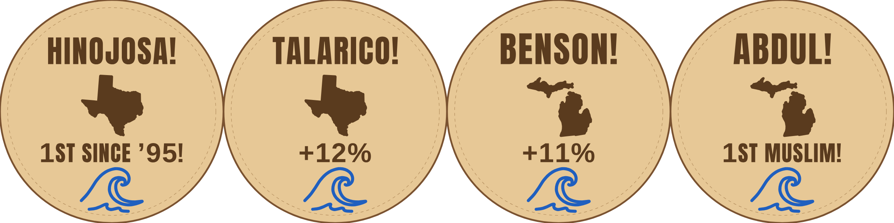
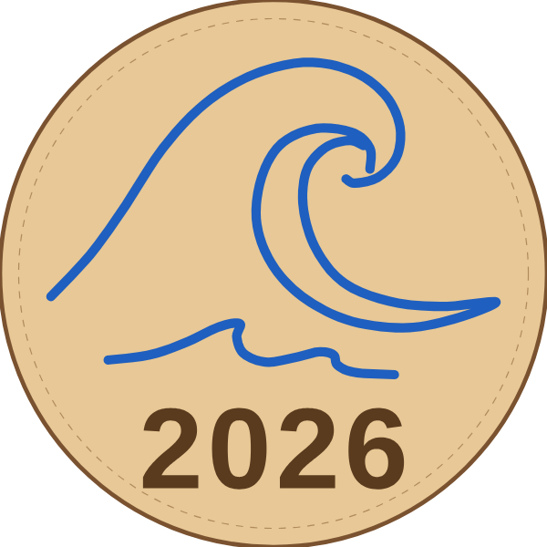

# Coasters – 2026 Blue Wave

Engraved political coasters on pre-cut live-edge softwood rounds (3" / 76.2 mm workable diameter).
Folders: `steph/`, `deb/`, `mom/`, `lynda/`.

## steph/

| File | Name | Tagline | State |
|---|---|---|---|
| `steph_01_tx_governor_hinojosa.c2d` | HINOJOSA! | 1ST SINCE 1995 | Texas |
| `steph_02_tx_senate_talarico.c2d` | TALARICO! | +12% | Texas |
| `steph_03_mi_governor_benson.c2d` | BENSON! | +11% | Michigan |
| `steph_04_mi_senate_abdul.c2d` | ABDUL! | 1ST MUSLIM | Michigan |



**Back side** (same for all four, milled on the opposite face): `steph_00_back_wave_2026.c2d` –
line-art breaking wave cut as 1.3 mm grooves for blue epoxy, with "2026" in Arial Bold beneath.



**Setup** (matches `wall_lake_coasters/wall_lake_house.c2d`): Nomad Pro, softwood, 3" square stock area,
XY zero at the coaster centre, Z zero at the top surface. All artwork stays inside a 71 mm circle.

| Layer | Toolpath | Tool | Depth |
|---|---|---|---|
| `text` | pocket | #122 1/32" flat | 1.27 mm |
| `state` | pocket | #122 1/32" flat | 1.27 mm |
| `wave` (back) | pocket – fill with blue epoxy | #122 1/32" flat | 1.524 mm |
| `year` (back) | pocket | #122 1/32" flat | 1.27 mm |

Toolpaths are layer-based; Carbide Create computes them when the file is opened (no G-code stored).

## Regenerating

```bash
pip install shapely fonttools
python3 scripts/coasters_blue_wave.py
```

Layout constants (text sizes, band positions, depths) are at the top of the script.
Names use Anton (`fonts/Anton-Regular.ttf`, SIL OFL). Numbers use Arial Bold if `fonts/arialbd.ttf`
exists, otherwise Liberation Sans Bold (metric-compatible Arial clone). State outlines come from
US Census boundaries via us-atlas (`data/states_tx_mi.geojson`).
